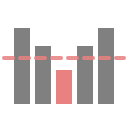
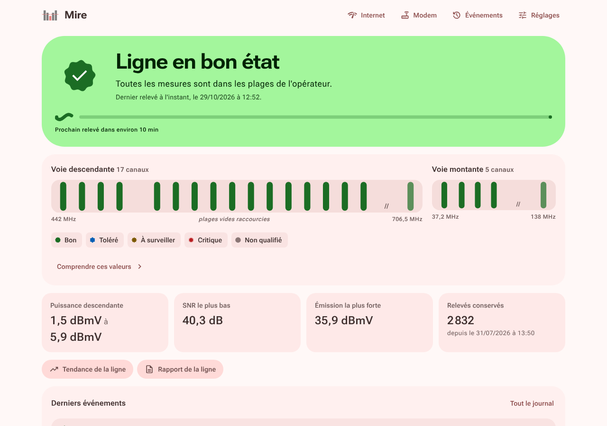
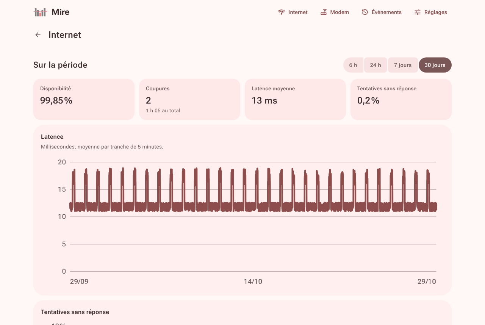
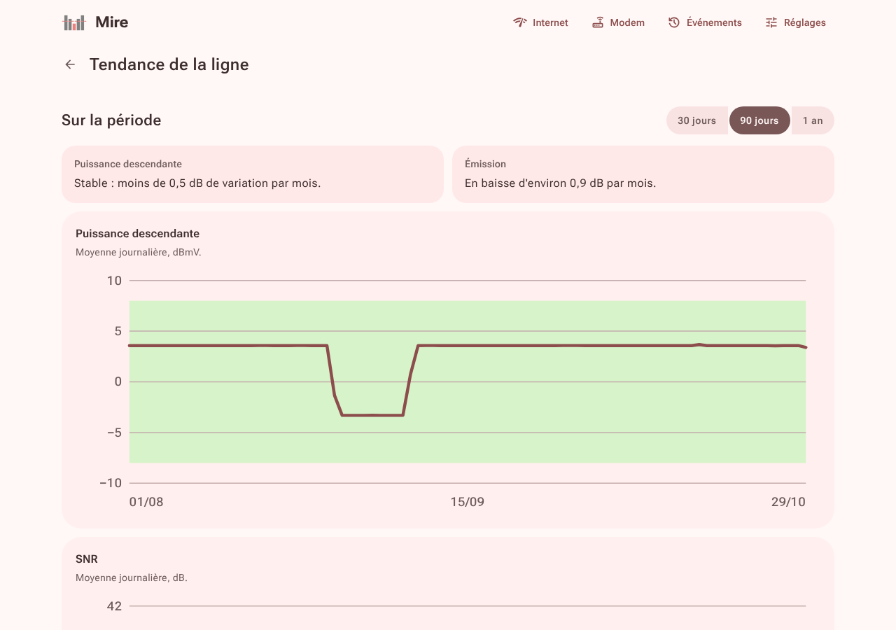
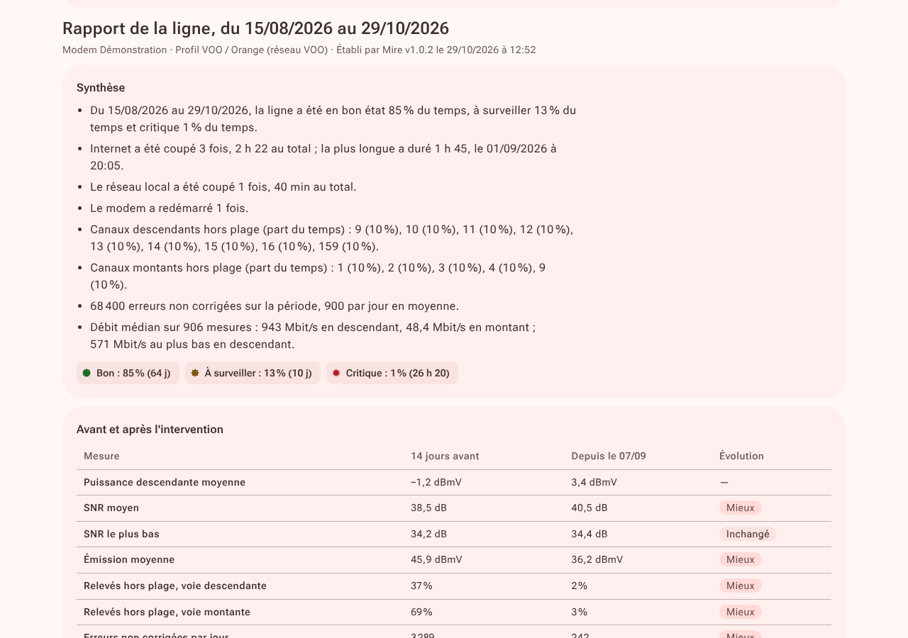
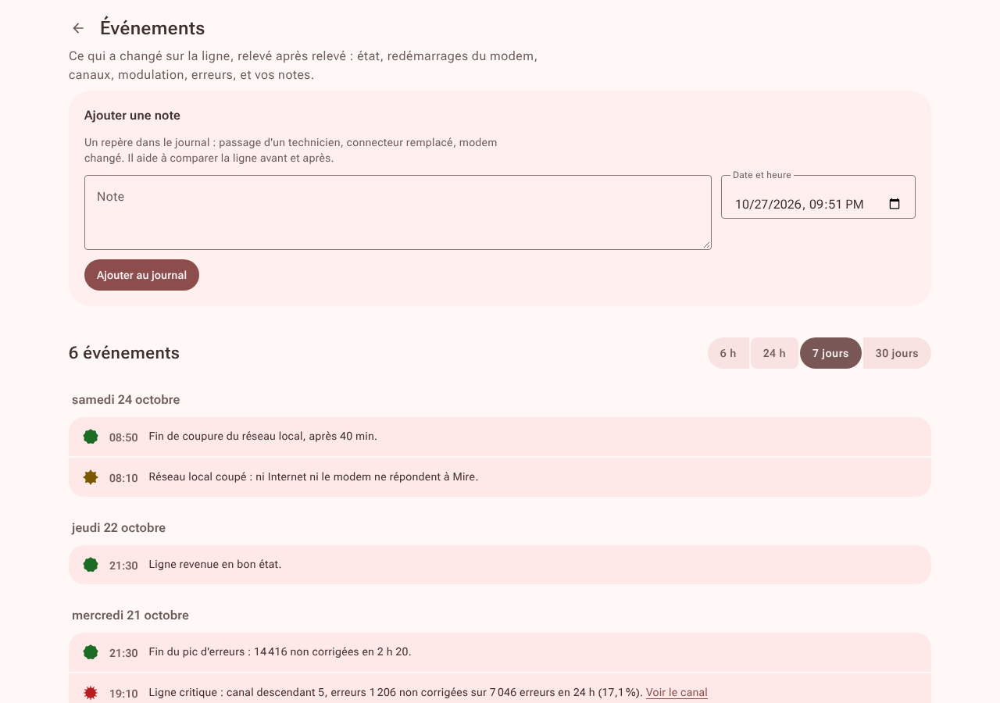

<p align="center"></p>

<h1 align="center">Mire</h1>

<p align="center">Surveillance continue d'une ligne câble DOCSIS.</p>



Mire relève les mesures du modem câble, les conserve et juge chaque canal selon les seuils de l'opérateur.

> **In English.** Mire monitors a DOCSIS cable line: it polls the modem, keeps every reading and rates each channel against the operator's thresholds. French interface; profiles for the VOO and Telenet networks (Belgium), driver for the Technicolor CGA4233.

## Fonctionnalités

- **État de la ligne** : chaque canal classé bon, toléré, à surveiller ou critique, avec la cause.
- **Journal** : changements d'état, redémarrages, canaux perdus, pics d'erreurs, sauts de puissance, notes.
- **Internet** : coupures, latence heure par heure, débit (Speedtest Tracker ou passerelle UniFi).
- **Tendance** : évolution sur 30 jours à un an, avec la température extérieure.
- **Rapport** : bilan d'une période en PDF, comparaison avant et après une intervention, export CSV.
- **Modem** : informations, réseau domestique, redémarrage.
- **Notifications** : ntfy, Gotify, Discord, Telegram, Slack, mail, webhook.
- **Intégrations** : métriques Prometheus, Home Assistant par MQTT.
- **Léger** : un binaire ou une image Docker, une base SQLite ; installable comme application.

## Aperçu

| | |
|---|---|
|  |  |
|  |  |

## Installation

`compose.yaml` :

```yaml
services:
  mire:
    image: ghcr.io/floopich/mire:latest
    container_name: mire
    restart: unless-stopped
    ports:
      - "1340:1340"
    volumes:
      - mire-data:/data
    read_only: true
    tmpfs:
      - /tmp:mode=1777
    cap_drop:
      - ALL
    security_opt:
      - no-new-privileges:true

volumes:
  mire-data:
```

`docker compose up -d`, puis `http://<machine>:1340` : essayez la démo, ou configurez Mire : mot de passe, opérateur, modem, puis options facultatives.

- **Mettre à jour** : `docker compose pull && docker compose up -d`.
- **Démo seule** : `docker run --rm -p 1340:1340 -e MIRE_DEMO=true ghcr.io/floopich/mire:latest`.
- **Sans Docker** : binaires Linux et Windows dans les [Releases](https://github.com/floopich/mire/releases), voir [Installation sans Docker](docs/configuration.md#installation-sans-docker).

## Modems et opérateurs

| Modem | Opérateur |
|---|---|
| Technicolor CGA4233 (firmware VOO) | VOO |

| Profil | Réseau |
|---|---|
| VOO / Orange | réseau VOO : Wallonie, une partie de Bruxelles |
| Telenet / Orange | réseau Telenet : Flandre, une partie de Bruxelles |
| Autre opérateur | relevés conservés, sans jugement de la ligne |

Modem absent de la liste : choisissez « Autre modem », puis **Proposer mon modem** dans la page Modem.

## Documentation

- [Fonctionnement](docs/fonctionnement.md)
- [Configuration](docs/configuration.md)
- [Intégrations](docs/integrations.md)
- [Contribuer](CONTRIBUTING.md)

## Licence

MIT, voir [LICENSE](LICENSE). Roboto Flex (SIL Open Font License 1.1) et Material Symbols (Apache License 2.0), licences dans `internal/webview/assets/`.
