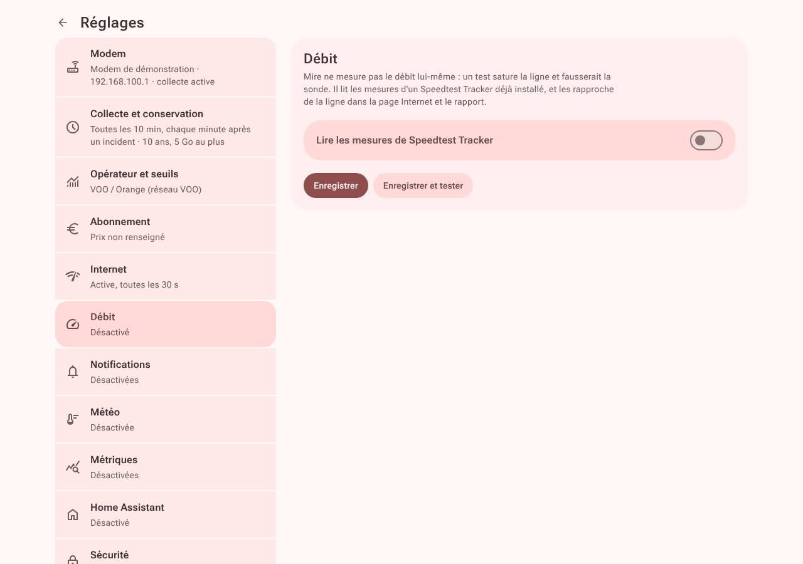
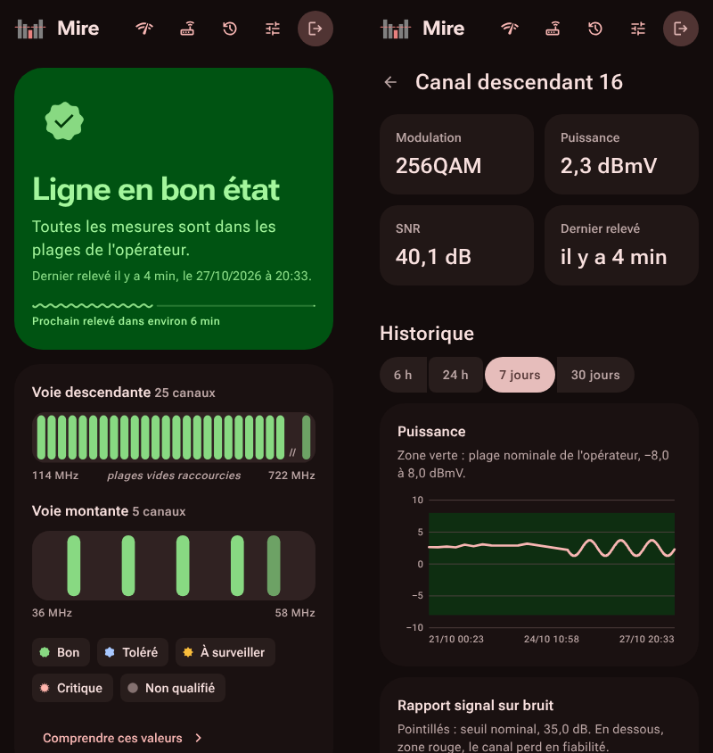

# Configuration et exploitation

## Réglages

La page **Réglages** est une liste de rubriques, chacune résumée en une ligne : ce qui est réglé, et ce qui reste à faire. Sur un grand écran, la liste et la rubrique ouverte sont côte à côte ; sur un téléphone, la liste mène à la rubrique.

| Rubrique | Contenu |
|---|---|
| Modem | modèle, adresse, identifiant et mot de passe ; « Enregistrer et tester », « Détecter le modem » |
| Collecte et conservation | intervalle entre deux relevés, relevés rapprochés après un incident, durée et taille de conservation |
| Opérateur et seuils | profil d'opérateur, modulation habituelle de la voie montante OFDMA |
| Abonnement | prix mensuel, pour la compensation légale (opérateur belge) |
| Internet | sonde de connexion : cibles et intervalle |
| Débit | source (Speedtest Tracker ou passerelle UniFi), adresse, jeton ou clé API, compte local UniFi, essai |
| Notifications | service, événements envoyés, essai |
| Météo | commune ou coordonnées, essai ; température pour la page Tendance |
| Métriques | publication sur `/metrics`, jeton d'accès |
| Home Assistant | serveur MQTT, identifiant, préfixe de découverte, bouton de redémarrage, essai |
| Sécurité, Sauvegarde | mot de passe de l'interface, copie de la base |

Un changement s'applique aussitôt, sans redémarrer.



## Variables d'environnement

Chaque réglage accepte une variable d'environnement, facultative : une variable définie **l'emporte et verrouille** le champ dans l'interface, qui indique laquelle le fixe. Elle se place dans une section `environment:` du service, ou dans un fichier `.env` (modèle : [.env.exemple](../.env.exemple)) déclaré par `env_file: .env`.

| Variable | Défaut | Rôle |
|---|---|---|
| `MIRE_MODELE` | celui du profil | modèle du modem, voir `mire modeles` ; `generique` pour un modem non pris en charge |
| `MIRE_MODEM` | celle du profil | adresse du modem, `http://192.168.100.1` chez VOO |
| `MIRE_UTILISATEUR` | celui du modèle | identifiant du modem |
| `MIRE_MODEM_MOT_DE_PASSE` | — | mot de passe du modem ; sans lui, la collecte reste arrêtée (l'ancien nom `MIRE_MODEM_PASSWORD` reste accepté) |
| `MIRE_INTERVALLE` | `10m` | délai entre deux relevés, une minute au minimum |
| `MIRE_RAPPROCHE` | `true` | relevés toutes les minutes pendant le quart d'heure qui suit un incident du journal |
| `MIRE_PROFIL` | `voo` | profil d'opérateur : `voo` (VOO, Orange sur VOO), `telenet` (Telenet, Orange sur Telenet) ou `generique` |
| `MIRE_OFDMA_PLANCHER` | celle du profil | modulation habituelle de la voie montante OFDMA, en ordre QAM : `16` pour 16QAM |
| `MIRE_ABONNEMENT` | — | prix mensuel de l'abonnement en euros, pour la compensation légale belge |
| `MIRE_RETENTION` | `3650` | conservation en jours, 0 pour illimitée |
| `MIRE_TAILLE_MAX` | `5` | plafond de la base en Go, 0 pour illimité |
| `MIRE_SONDE` | `true` | sonde Internet active ou non |
| `MIRE_SONDE_CIBLES` | `1.1.1.1:443 8.8.8.8:443 9.9.9.9:443` | cibles de la sonde, `hôte:port` séparés par des espaces, cinq au plus |
| `MIRE_SONDE_INTERVALLE` | `30s` | délai entre deux tentatives, de 10 secondes à 10 minutes |

Les notifications se règlent de la même façon :

| Service | Variables |
|---|---|
| Commun | `MIRE_NOTIF` (`true` pour activer), `MIRE_NOTIF_SERVICE` (`ntfy`, `gotify`, `discord`, `telegram`, `slack`, `mail`, `webhook`), `MIRE_NOTIF_FILTRE` (`etat`, `critiques`, `tout`), `MIRE_NOTIF_ADRESSE` (adresse de Mire, pour le lien des messages) |
| ntfy | `MIRE_NTFY_SERVEUR` (`https://ntfy.sh` par défaut), `MIRE_NTFY_SUJET`, `MIRE_NTFY_JETON` |
| Gotify | `MIRE_GOTIFY_SERVEUR`, `MIRE_GOTIFY_JETON` |
| Discord | `MIRE_DISCORD_WEBHOOK` |
| Telegram | `MIRE_TELEGRAM_JETON`, `MIRE_TELEGRAM_CHAT` |
| Slack | `MIRE_SLACK_WEBHOOK` |
| Mail | `MIRE_MAIL_SERVEUR` (`serveur:port`), `MIRE_MAIL_SECURITE` (`starttls`, `tls`, `aucun`), `MIRE_MAIL_IDENTIFIANT`, `MIRE_MAIL_MOT_DE_PASSE`, `MIRE_MAIL_EXPEDITEUR`, `MIRE_MAIL_DESTINATAIRE` |
| Webhook | `MIRE_WEBHOOK_URL` |

La météo, les métriques et Home Assistant aussi :

| Fonction | Variables |
|---|---|
| Débit | `MIRE_DEBIT` (`true` pour lire les mesures), `MIRE_DEBIT_SOURCE` (`speedtest-tracker` par défaut, ou `unifi`), `MIRE_DEBIT_ADRESSE`, `MIRE_DEBIT_JETON` (jeton ou clé API), `MIRE_DEBIT_IDENTIFIANT` et `MIRE_DEBIT_MOT_DE_PASSE` (compte local UniFi) |
| Météo | `MIRE_METEO` (`true` pour relever la température), `MIRE_METEO_POSITION` (commune, ou `latitude, longitude`) |
| Métriques | `MIRE_METRIQUES` (`true` pour publier), `MIRE_METRIQUES_JETON` |
| Home Assistant | `MIRE_MQTT` (`true` pour publier), `MIRE_MQTT_SERVEUR` (`mqtt://hôte:1883` ou `mqtts://hôte:8883`), `MIRE_MQTT_IDENTIFIANT`, `MIRE_MQTT_MOT_DE_PASSE`, `MIRE_MQTT_PREFIXE` (`homeassistant` par défaut), `MIRE_MQTT_REDEMARRAGE` (`true` par défaut : bouton de redémarrage du modem) |

Cinq variables concernent le service lui-même et ne figurent pas dans la page :

| Variable | Défaut | Rôle |
|---|---|---|
| `TZ` | celui de l'opérateur | fuseau horaire des heures affichées, par exemple `Europe/Paris` |
| `MIRE_DONNEES` | `.` (`/data` dans l'image) | dossier de la base |
| `MIRE_ECOUTE` | `0.0.0.0:1340` | adresse d'écoute de l'interface |
| `MIRE_VERBEUX` | `false` | journalise chaque relevé |
| `MIRE_DEMO` | `false` | démonstration sur une ligne fictive : base jetable, interface sans mot de passe |

Chaque variable a son option équivalente (`mire -h`), sauf le mot de passe du modem : la ligne de commande est lisible par tous les utilisateurs de la machine.

Les données restent dans un seul fichier SQLite, `mire.db`, sans base externe à installer.

## Docker

L'image existe pour `amd64`, `arm64` et `armv7` : NAS, mini-PC, Raspberry Pi.

| Tag de l'image | Contenu |
|---|---|
| `latest` | la dernière version publiée ; c'est celui à suivre |
| `1.2.3`, `1.2` | une version précise, ou la dernière correction d'une version |
| `main` | l'état courant du développement, pour essayer avant publication |

Mettre à jour : `docker compose pull && docker compose up -d`. Le volume des données est conservé. Les migrations de la base s'appliquent seules au démarrage ; faites une sauvegarde avant une mise à jour importante.

**Dossier des données.** Les relevés vivent dans le volume Docker `mire-data`, qui survit aux mises à jour et appartient d'emblée à l'utilisateur du conteneur (65532, sans privilèges). Pour un dossier visible sur la machine, remplacez `mire-data:/data` par `./data:/data` et donnez ce dossier à cet utilisateur avant le premier démarrage :

```bash
mkdir data && sudo chown 65532:65532 data
```

Sans cela, Mire refuse de démarrer et le journal du conteneur (`docker compose logs mire`) indique la commande à lancer.

L'heure affichée est celle du fuseau de l'opérateur (Bruxelles pour les profils belges) ; l'adresse de la première visite sert de lien dans les notifications.

## Installation sans Docker

Chaque version publie des binaires statiques (Linux amd64, arm64, armv7 et Windows) et leurs sommes de contrôle dans les [Releases](https://github.com/floopich/mire/releases). Pour un essai : `./mire -donnees ./donnees`, puis ouvrez `http://<machine>:1340`.

Pour un service permanent sous Linux, avec systemd, en root :

```bash
A=linux-amd64   # ou linux-arm64, linux-armv7
curl -fsSLO https://github.com/floopich/mire/releases/latest/download/mire-$A
curl -fsSLO https://github.com/floopich/mire/releases/latest/download/SHA256SUMS
sha256sum --check --ignore-missing SHA256SUMS
install -m 755 mire-$A /usr/local/bin/mire
useradd --system --home-dir /var/lib/mire --shell /usr/sbin/nologin mire
curl -fsSL -o /etc/systemd/system/mire.service https://raw.githubusercontent.com/floopich/mire/main/deploy/mire.service
systemctl daemon-reload && systemctl enable --now mire
```

Ouvrez ensuite `http://<machine>:1340` : le même assistant prend la suite. Le service tourne sous le compte `mire`, sans privilèges, et n'écrit que dans `/var/lib/mire`. Pour imposer un réglage, facultatif : `/etc/mire/mire.env`, au format de [.env.exemple](../.env.exemple), lisible par le seul groupe `mire`. Mettre à jour : relancez les quatre premières lignes (téléchargement et vérification), puis `install -m 755 mire-$A /usr/local/bin/mire && systemctl restart mire`. Le journal se lit avec `journalctl -u mire`.

## Commandes

| Commande | Rôle |
|---|---|
| `mire` | collecte les relevés et sert l'interface |
| `mire releve` | prend un seul relevé et l'enregistre : test depuis la ligne de commande |
| `mire sauvegarde FICHIER` | copie la base dans un fichier, sans arrêter le service ; `-` l'écrit sur la sortie standard |
| `mire restauration FICHIER` | remplace la base par une sauvegarde, service arrêté ; `-` la lit sur l'entrée standard |
| `mire mot-de-passe` | change le mot de passe de l'interface, s'il est perdu, et ferme les sessions |
| `mire sante` | vérifie qu'une instance répond (sonde de l'image Docker) |
| `mire detecter` | cherche le modem sur le réseau |
| `mire diagnostic` | écrit le rapport anonymisé et lisible du modem, à joindre à une demande, même pour un modèle inconnu (`-modem http://adresse`) ; lecture seule |
| `mire modeles` | liste les modems pris en charge |
| `mire version` | affiche la version |

Avec Docker : `docker compose exec -it mire mire mot-de-passe`, ou `docker compose exec -T mire mire diagnostic > modem.txt`.

## Sauvegarde

Toute l'histoire de la ligne tient dans la base `mire.db`. Pour la sauvegarder sans arrêter la collecte :

- depuis l'interface : **Réglages**, puis **Sauvegarde**, puis « Télécharger une sauvegarde » ;
- en ligne de commande, à planifier par exemple chaque nuit :

```bash
# Docker : la copie sort du conteneur, sans toucher au volume
docker compose exec -T mire mire sauvegarde - > mire-$(date +%F).db
# Sans Docker
mire sauvegarde /chemin/mire-sauvegarde.db
```

La copie est cohérente et compactée, et ne remplace jamais un fichier existant. Elle contient le mot de passe du modem, comme la base : gardez-la à l'abri.

Pour **restaurer**, Mire doit être arrêté. La commande vérifie que la copie est une base de Mire intacte, garde l'ancienne base à côté sous un nom daté, puis met la copie en place ; une sauvegarde plus ancienne est mise à jour au démarrage suivant.

```bash
# Docker
docker compose stop mire
docker compose run --rm -T mire restauration - < mire-2026-10-27.db
docker compose start mire
# Sans Docker, service arrêté
mire restauration /chemin/mire-sauvegarde.db
```

## Derrière un proxy inverse

Mire s'installe à la racine d'un nom de domaine (`https://mire.exemple.be`). Le cookie de session passe en `Secure` dès que le proxy transmet `X-Forwarded-Proto: https`. Le limiteur de tentatives de connexion se base sur l'adresse de la connexion : derrière un proxy, tous les appelants partagent le même compteur.

## Installer comme une application



Mire s'installe sur l'écran d'accueil d'un téléphone ou comme application de bureau : icône dédiée, fenêtre sans barre d'adresse.

- **Android, Chrome, Edge** : menu du navigateur, « Installer l'application ».
- **iPhone, iPad** : Safari, bouton Partager, « Sur l'écran d'accueil ».

Les navigateurs n'installent une application que servie en HTTPS, ou depuis `localhost` : derrière un proxy inverse, c'est le cas. En HTTP simple sur le réseau local, ils proposent au mieux un raccourci vers la page.

Mire n'a pas de mode hors ligne : tout vient de l'instance, et une page sans elle n'aurait rien à montrer.

## Sécurité

- Aucun mot de passe par défaut : il est choisi à la première visite, et l'assistant se ferme dès qu'il existe.
- Le mot de passe de l'interface est conservé sous forme d'empreinte. Celui du modem doit pouvoir être relu pour l'interroger : il est enregistré dans la base et jamais réaffiché. Protégez le dossier de données, ou passez-le par `MIRE_MODEM_MOT_DE_PASSE` dans un fichier `.env` lisible par son seul propriétaire (`chmod 600 .env`).
- Sessions de 30 jours, stockées sous forme d'empreinte ; cookie `HttpOnly` et `SameSite=Strict`.
- Formulaires refusés depuis une autre origine (`Sec-Fetch-Site`, puis `Origin`).
- Aucun script ni ressource externe : la politique de sécurité du contenu n'autorise que la feuille de style, la police et les images de l'instance.
- Image sans shell, exécutée en utilisateur non root.
- Rien ne sort du réseau local, sauf les poignées de main TCP de la sonde vers ses cibles, que l'on peut changer ou couper, et ce que vous activez : notifications, serveur MQTT, météo (la seule position choisie, vers Open-Meteo), source du débit.
