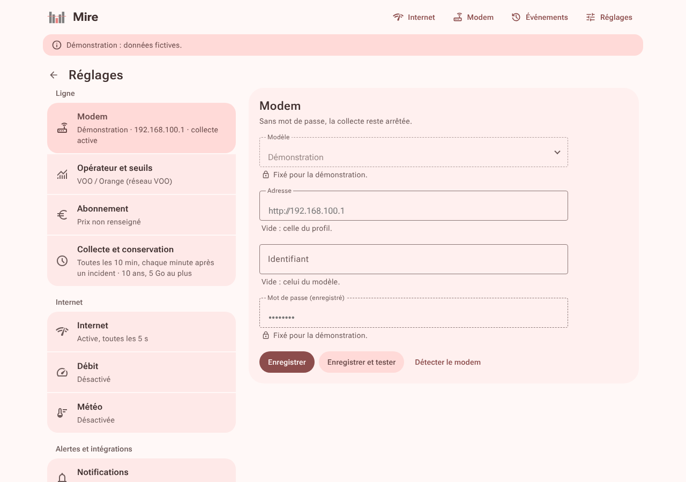
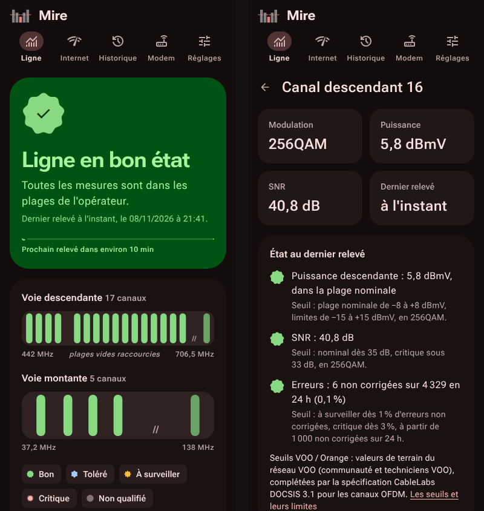

# Configuration et exploitation

## Réglages

Un changement s'applique aussitôt, sans redémarrer.

| Groupe | Rubrique | Contenu |
|---|---|---|
| Ligne | Modem | modèle, adresse, identifiant et mot de passe ; « Enregistrer et tester », « Détecter le modem » |
|  | Opérateur et seuils | profil d'opérateur, modulation habituelle de la voie montante OFDMA |
|  | Abonnement | prix mensuel, pour la compensation légale (opérateur belge) |
|  | Collecte et conservation | intervalle entre deux relevés, relevés rapprochés après un incident, durée et taille de conservation |
| Internet | Internet | sonde de connexion : cibles et intervalle |
|  | Débit | source (Speedtest Tracker ou passerelle UniFi), adresse, jeton ou clé API, compte local UniFi, essai |
|  | Météo | commune ou coordonnées, essai ; température pour la page Tendance |
| Alertes et intégrations | Notifications | service, événements envoyés, essai |
|  | Supervision | état de la ligne (`/sante`, `/sante/prtg`), métriques Prometheus (`/metrics`), jeton d'accès commun, signal de vie ; fiche prête pour Uptime Kuma, PRTG, Gatus, Zabbix, Healthchecks.io, Prometheus |
|  | Home Assistant | serveur MQTT, identifiant, préfixe de découverte, bouton de redémarrage, essai |
| Système | Application | style de l'icône de l'application installée : classique, sombre, couleurs inversées, noir et blanc ; thème de l'interface : automatique, clair, sombre |
|  | Journal | niveau de détail, dernières lignes du service, téléchargement |
|  | Sauvegarde | copie automatique chaque jour, nombre de copies gardées, téléchargement d'une copie |
|  | Nouvelles versions | avis d'une nouvelle version, désactivé par défaut |
|  | Sécurité | mot de passe de l'interface |



## Variables d'environnement

Facultatives. Une variable définie **verrouille** le réglage dans la page. À placer dans `environment:`, ou dans un fichier `.env` déclaré par `env_file: .env` (modèle : [.env.exemple](../.env.exemple)).

| Variable | Défaut | Rôle |
|---|---|---|
| `MIRE_MODELE` | celui du profil | modèle du modem, voir `mire modeles` ; `snmp` pour un modem DOCSIS standard lu en SNMP (expérimental) ; `generique` pour un modem non pris en charge |
| `MIRE_MODEM` | celle du profil | adresse du modem, `http://192.168.100.1` chez VOO |
| `MIRE_UTILISATEUR` | celui du modèle | identifiant du modem ; en SNMP, la communauté (`public` est essayé aussi) |
| `MIRE_MODEM_MOT_DE_PASSE` | — | mot de passe du modem ; sans lui, la collecte reste arrêtée (inutile en SNMP) |
| `MIRE_INTERVALLE` | `10m` | délai entre deux relevés, une minute au minimum |
| `MIRE_RAPPROCHE` | `true` | relevés toutes les minutes pendant le quart d'heure qui suit un incident |
| `MIRE_PROFIL` | `voo` | profil d'opérateur : `voo` (VOO, Orange sur VOO), `telenet` (Telenet, Orange sur Telenet) ou `generique` |
| `MIRE_OFDMA_PLANCHER` | celle du profil | modulation habituelle de la voie montante OFDMA, en ordre QAM : `16` pour 16QAM |
| `MIRE_ABONNEMENT` | — | prix mensuel de l'abonnement en euros, pour la compensation légale belge |
| `MIRE_RETENTION` | `3650` | conservation en jours, 0 pour illimitée |
| `MIRE_TAILLE_MAX` | `5` | plafond de la base en Go, 0 pour illimité |
| `MIRE_SONDE` | `true` | sonde Internet active ou non |
| `MIRE_SONDE_CIBLES` | `1.1.1.1:443 8.8.8.8:443 9.9.9.9:443` | cibles de la sonde, `hôte:port` séparés par des espaces, cinq au plus |
| `MIRE_SONDE_INTERVALLE` | `5s` | délai entre deux tentatives, de 5 secondes à 10 minutes ; au-delà de 30 secondes, les micro-coupures ne se voient plus |
| `MIRE_JOURNAL` | `normal` | niveau du journal : `erreurs`, `normal` ou `detaille` (une ligne par relevé) |
| `MIRE_SAUVEGARDE` | `true` | copie automatique chaque jour, dans `sauvegardes` |
| `MIRE_SAUVEGARDE_COPIES` | `7` | copies automatiques gardées, de 1 à 365 |
| `MIRE_AVIS_VERSION` | `false` | signale une nouvelle version : une fois par jour, Mire demande à GitHub le numéro de la dernière |
| `MIRE_ICONE` | `classique` | icône de l'application installée : `classique`, `sombre`, `inversee`, `noir-blanc` |
| `MIRE_THEME` | `auto` | thème de l'interface : `auto` (celui de l'appareil), `clair`, `sombre` |

Notifications :

| Service | Variables |
|---|---|
| Commun | `MIRE_NOTIF` (`true` pour activer), `MIRE_NOTIF_SERVICE` (`ntfy`, `gotify`, `discord`, `telegram`, `slack`, `mail`, `webhook`), `MIRE_NOTIF_FILTRE` (`etat`, `critiques`, `tout`), `MIRE_NOTIF_ADRESSE` (adresse de Mire, pour le lien des messages) |
| ntfy | `MIRE_NTFY_SERVEUR` (`https://ntfy.sh` par défaut), `MIRE_NTFY_SUJET`, `MIRE_NTFY_JETON` |
| Gotify | `MIRE_GOTIFY_SERVEUR`, `MIRE_GOTIFY_JETON` |
| Discord | `MIRE_DISCORD_WEBHOOK` |
| Telegram | `MIRE_TELEGRAM_JETON`, `MIRE_TELEGRAM_CHAT` |
| Slack | `MIRE_SLACK_WEBHOOK` |
| Mail | `MIRE_MAIL_SERVEUR` (`serveur:port`), `MIRE_MAIL_SECURITE` (`starttls`, `tls`, `aucun`), `MIRE_MAIL_IDENTIFIANT`, `MIRE_MAIL_MOT_DE_PASSE`, `MIRE_MAIL_EXPEDITEUR`, `MIRE_MAIL_DESTINATAIRE` |
| Webhook | `MIRE_WEBHOOK_URL` |

Débit, météo, métriques et Home Assistant :

| Fonction | Variables |
|---|---|
| Débit | `MIRE_DEBIT` (`true` pour lire les mesures), `MIRE_DEBIT_SOURCE` (`speedtest-tracker` par défaut, ou `unifi`), `MIRE_DEBIT_ADRESSE`, `MIRE_DEBIT_JETON` (jeton ou clé API), `MIRE_DEBIT_IDENTIFIANT` et `MIRE_DEBIT_MOT_DE_PASSE` (compte local UniFi) |
| Météo | `MIRE_METEO` (`true` pour relever la température), `MIRE_METEO_POSITION` (commune, ou `latitude, longitude`) |
| Supervision | `MIRE_SUPERVISION` (`true` pour publier l'état de la ligne dans `/sante` et `/sante/prtg`), `MIRE_METRIQUES` (`true` pour publier `/metrics`), `MIRE_METRIQUES_JETON` (jeton commun aux deux), `MIRE_SIGNAL_DE_VIE` (adresse appelée après chaque relevé réussi) |
| Home Assistant | `MIRE_MQTT` (`true` pour publier), `MIRE_MQTT_SERVEUR` (`mqtt://hôte:1883` ou `mqtts://hôte:8883`), `MIRE_MQTT_IDENTIFIANT`, `MIRE_MQTT_MOT_DE_PASSE`, `MIRE_MQTT_PREFIXE` (`homeassistant` par défaut), `MIRE_MQTT_REDEMARRAGE` (`true` par défaut : bouton de redémarrage du modem) |

Service, hors de la page Réglages :

| Variable | Défaut | Rôle |
|---|---|---|
| `TZ` | celui de l'opérateur | fuseau horaire des heures affichées, par exemple `Europe/Paris` |
| `MIRE_DONNEES` | `.` (`/data` dans l'image) | dossier de la base |
| `MIRE_ECOUTE` | `0.0.0.0:1340` | adresse d'écoute de l'interface |
| `MIRE_DEMO` | `false` | démonstration sur une ligne fictive : base jetable, interface sans mot de passe |
| `MIRE_PROXY_DE_CONFIANCE` | aucun | proxys inverses dont l'en-tête `X-Forwarded-For` est cru, adresses ou plages : `172.18.0.0/16`. Facultatif : sans lui, derrière un proxy, trois fautes de frappe bloquent tout le monde quelques minutes |
| `MIRE_CLE_SECRETS` | aucune | clé de chiffrement des secrets enregistrés, 64 caractères hexadécimaux (`openssl rand -hex 32`) ; voir plus bas |

Chaque variable a son option en ligne de commande (`mire -h`), sauf le mot de passe du modem, les proxys de confiance et la clé des secrets. Les données tiennent dans un fichier SQLite, `mire.db`.

**Secrets dans un fichier (facultatif).** Chaque mot de passe ou jeton peut aussi se lire dans un fichier, en ajoutant `_FICHIER` au nom de sa variable : `MIRE_MODEM_MOT_DE_PASSE_FICHIER=/run/secrets/modem`. Le secret n'apparaît alors ni dans `docker inspect` ni dans l'environnement du conteneur. Les deux formes à la fois pour un même secret empêchent le démarrage, comme un fichier vide ou illisible. Avec les secrets Docker :

```yaml
services:
  mire:
    environment:
      MIRE_MODEM_MOT_DE_PASSE_FICHIER: /run/secrets/modem
    secrets: [modem]
secrets:
  modem:
    file: ./modem.secret
```

**Secrets chiffrés dans la base (facultatif).** Sans réglage, les mots de passe et jetons saisis dans la page Réglages sont enregistrés en clair dans `mire.db`, lisible par le seul compte du service. Avec une clé gardée hors du dossier des données, ils sont chiffrés (AES-256-GCM) : une copie de la base, du volume ou une sauvegarde complète ne les livre plus sans la clé.

```bash
openssl rand -hex 32 > mire-cle.secret && chmod 600 mire-cle.secret
```

```yaml
services:
  mire:
    environment:
      MIRE_CLE_SECRETS_FICHIER: /run/secrets/mire-cle
    secrets: [mire-cle]
secrets:
  mire-cle:
    file: ./mire-cle.secret
```

Au démarrage suivant, les secrets déjà enregistrés sont chiffrés ; le journal l'indique. `MIRE_CLE_SECRETS` donne aussi la clé directement. Gardez la clé à part : sans elle, Mire refuse de démarrer sur cette base et une sauvegarde complète ne se restaure pas (une copie sans secrets, si). Une clé différente est refusée de même, plutôt que d'envoyer un mot de passe faux au modem.

Revenir sans chiffrement, ou changer de clé : Mire arrêté, `mire dechiffrer` avec la clé actuelle, puis démarrez sans clé ou avec la nouvelle.

```bash
docker compose stop mire
docker compose run --rm mire dechiffrer
docker compose start mire   # après avoir retiré ou remplacé la clé
```

## Docker

Image pour `amd64`, `arm64` et `armv7`.

| Tag de l'image | Contenu |
|---|---|
| `latest`, `stable` | dernière version publiée |
| `testing` | dernière version, versions de test comprises (`1.9.0-rc1`), puis la version finale |
| `1.2.3`, `1.2` | version précise, ou dernière correction d'une version |
| `1` | dernière version 1.x : nouveautés et corrections, sans changement cassant |
| `main` | version en développement |

Mettre à jour : `docker compose pull && docker compose up -d`. Les données sont conservées et la base est mise à jour au démarrage ; avant de la modifier, Mire en garde une copie à côté, `mire.db.avant-vN` (la plus récente seulement).

Être prévenu d'une nouvelle version : **Réglages, Nouvelles versions**, ou les notifications de GitHub (Watch, Custom, Releases). Une version stable n'annonce que des versions stables ; une version de test annonce aussi les versions de test suivantes.

**Essayer avant les autres** : remplacez `latest` par `testing` dans `compose.yaml`. Vous recevez chaque version de test, puis la version finale, sans revenir à la main sur `latest`. Une version de test peut contenir des erreurs : gardez une sauvegarde.

**Dossier des données.** Pour un dossier sur la machine plutôt que le volume `mire-data`, remplacez `mire-data:/data` par `./data:/data` et attribuez-le à l'utilisateur du conteneur (65532) avant le premier démarrage :

```bash
mkdir data && sudo chown 65532:65532 data
```

Sinon, Mire ne démarre pas et `docker compose logs mire` indique la commande à lancer.

## Installation sans Docker

Binaires Linux (amd64, arm64, armv7) dans les [Releases](https://github.com/floopich/mire/releases). Pour un essai : `./mire -donnees ./donnees`, puis `http://<machine>:1340`.

Service systemd sous Linux, en root :

```bash
A=linux-amd64   # ou linux-arm64, linux-armv7
U=https://github.com/floopich/mire/releases/latest/download
curl -fsSL --remote-name-all $U/mire-$A $U/mire.service $U/SHA256SUMS
sha256sum --check --ignore-missing SHA256SUMS
install -m 755 mire-$A /usr/local/bin/mire
install -m 644 mire.service /etc/systemd/system/mire.service
useradd --system --home-dir /var/lib/mire --shell /usr/sbin/nologin mire
systemctl daemon-reload && systemctl enable --now mire
```

Ouvrez ensuite `http://<machine>:1340`. Le service tourne sous le compte `mire` et n'écrit que dans `/var/lib/mire`. Réglages imposés, facultatifs : `/etc/mire/mire.env`, au format de [.env.exemple](../.env.exemple). Mise à jour : les six premières lignes, puis `systemctl daemon-reload && systemctl restart mire`. Journal : `journalctl -u mire`.

## Commandes

| Commande | Rôle |
|---|---|
| `mire` | collecte les relevés et sert l'interface |
| `mire releve` | prend un relevé et l'enregistre |
| `mire sauvegarde FICHIER` | copie la base, sans arrêter le service ; `-` pour la sortie standard ; `-sans-secrets` retire mots de passe et jetons |
| `mire restauration FICHIER` | remplace la base par une sauvegarde, service arrêté ; `-` pour l'entrée standard |
| `mire dechiffrer` | remet les secrets en clair avec la clé actuelle, service arrêté |
| `mire mot-de-passe` | change le mot de passe de l'interface et ferme les sessions |
| `mire sante` | vérifie qu'une instance répond |
| `mire detecter` | cherche le modem sur le réseau |
| `mire diagnostic` | rapport anonymisé du modem (`-modem http://adresse` pour un modèle inconnu) ; lecture seule |
| `mire modeles` | liste les modems pris en charge |
| `mire version` | affiche la version |

Avec Docker : `docker compose exec -it mire mire mot-de-passe`, ou `docker compose exec -T mire mire diagnostic > modem.txt`.

## Sauvegarde

**Automatique**, activée par défaut : une copie par jour, sans mots de passe ni jetons, dans le sous-dossier `sauvegardes` des données (`/data/sauvegardes` dans l'image). Les 7 dernières sont gardées. Ce dossier reste sur la même machine : incluez-le dans votre sauvegarde habituelle pour en garder une copie ailleurs.

**À la demande**, sans arrêter la collecte :

- dans l'interface : **Réglages, Sauvegarde**, « Sauvegarde complète » ou « Sans mots de passe ni jetons » ;
- en ligne de commande, par exemple chaque nuit :

```bash
# Docker
docker compose exec -T mire mire sauvegarde - > mire-$(date +%F).db
# Sans Docker
mire sauvegarde /chemin/mire-sauvegarde.db
```

La copie ne remplace jamais un fichier existant. Complète, elle contient le mot de passe du modem et les jetons, chiffrés si une clé est donnée : gardez-la à l'abri. Avec `-sans-secrets` (`mire sauvegarde -sans-secrets FICHIER`), mots de passe, jetons et sessions sont retirés ; après restauration, ils se ressaisissent, celui de l'interface compris.

**Restaurer**, Mire arrêté : l'ancienne base est conservée à côté, sous un nom daté.

```bash
# Docker
docker compose stop mire
docker compose run --rm -T mire restauration - < mire-2026-10-27.db
# ou une copie automatique, déjà dans le volume
docker compose run --rm mire restauration /data/sauvegardes/mire-20261027-031200-sans-secrets.db
docker compose start mire
# Sans Docker, service arrêté
mire restauration /chemin/mire-sauvegarde.db
```

## Derrière un proxy inverse

Mire doit être servi à la racine d'un nom de domaine (`https://mire.exemple.be`). Le cookie de session passe en `Secure` quand le proxy transmet `X-Forwarded-Proto: https`. Pour que le ralentissement des connexions vise la bonne personne, indiquez l'adresse du proxy dans `MIRE_PROXY_DE_CONFIANCE` (avec Docker, souvent le réseau du proxy, par exemple `172.18.0.0/16`).

## Installer comme une application



- **Android, Chrome, Edge** : menu du navigateur, « Installer l'application ».
- **iPhone, iPad** : Safari, Partager, « Sur l'écran d'accueil ».
- **Icône** : choisissez son style dans **Réglages, Application** avant d'installer. Une application déjà installée change d'icône d'elle-même sur Android et sur ordinateur, parfois après quelques jours ou une confirmation ; sur iPhone, réinstallez-la. Une version monochrome est fournie aux systèmes qui teintent les icônes.

L'installation demande une adresse en HTTPS.

## Sécurité

Voir [SECURITY.md](../SECURITY.md) : ce qui est protégé, ce qui ne l'est pas, et comment vérifier une image ou un binaire.
