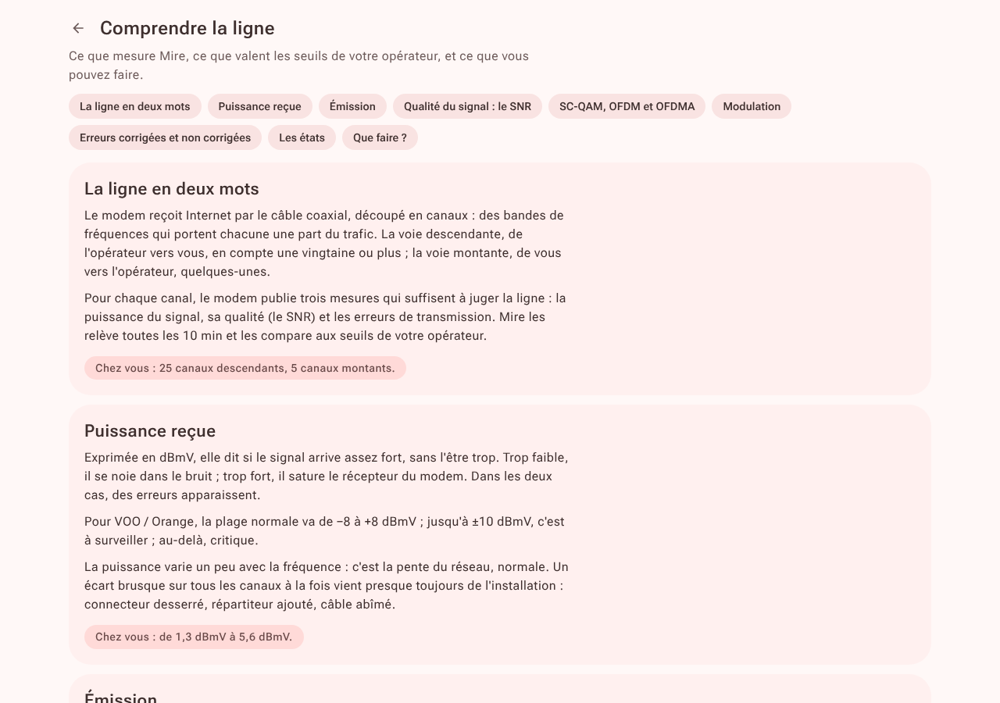
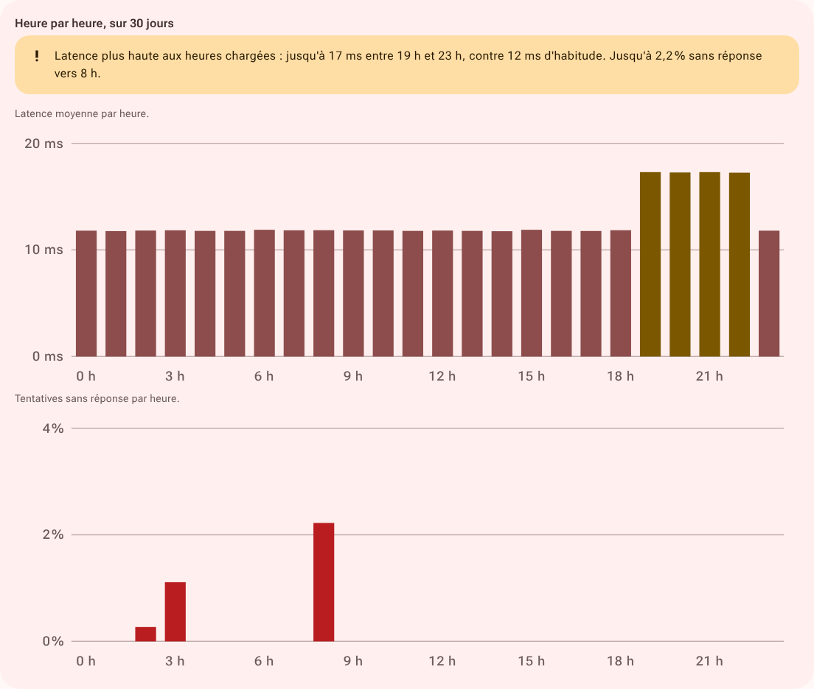
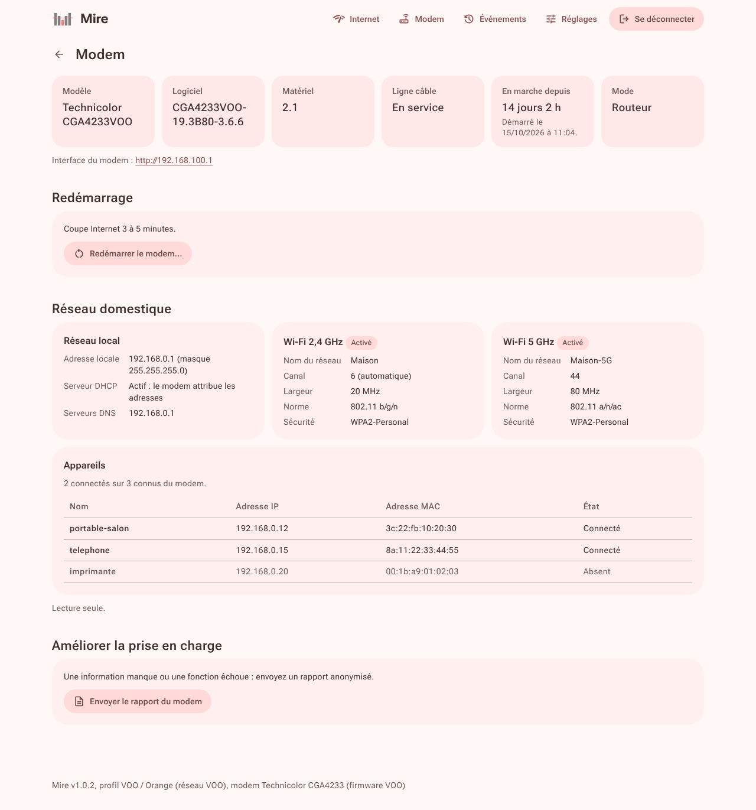

# Fonctionnement

## État de la ligne

Mire relève le modem toutes les 10 minutes, et toutes les minutes pendant le quart d'heure qui suit un incident. Chaque canal est classé selon les seuils de l'opérateur : bon, toléré, à surveiller ou critique.

- **Erreurs** : jugées sur les dernières 24 heures. Un canal est signalé à partir de 1 000 erreurs non corrigées et d'une part notable de ses erreurs.
- **Mesure douteuse** : un canal OFDM qui s'écarte de plus de 10 dB de ses voisins, alors que la réception est excellente.
- **Modulation habituelle OFDMA** : à déclarer dans les réglages si votre segment reste en basse modulation. Un cran en dessous : à surveiller ; deux crans : critique.

La page **Comprendre la ligne** détaille chaque mesure avec les seuils de l'opérateur et vos valeurs.

## Journal

| Événement | Déclencheur |
|---|---|
| Changement d'état | la ligne change d'état ; la cause est nommée |
| Redémarrage du modem | compteurs d'erreurs ou durée de fonctionnement remis à zéro |
| Redémarrage non effectué | durée de fonctionnement qui court toujours 10 minutes après une demande |
| Canal perdu, retrouvé | un canal disparaît du relevé, ou revient |
| Modulation | un canal change de modulation |
| Pic d'erreurs | plus de 1 000 erreurs non corrigées entre deux relevés |
| Saut de puissance | variation moyenne de plus de 2 dB (voie descendante) ou 3 dB (voie montante) entre deux relevés |
| Modem injoignable | deux relevés manqués de suite |

Vous pouvez ajouter des notes datées : « technicien passé », « connecteur remplacé ». Elles ne sont pas envoyées en notification.

## Internet

Toutes les 30 secondes, une sonde ouvre une connexion TCP vers `1.1.1.1`, `8.8.8.8` et `9.9.9.9` (port 443), sans rien transmettre.

- **Coupure** : trois tentatives sans réponse de suite, soit environ 90 secondes.
- **Cause** : si le modem répond pendant la coupure, la ligne ; sinon, le réseau local.
- **Latence et pertes** : par tranches de 5 minutes.
- **Heure par heure** : 30 jours ramenés sur une journée, disponible après 3 jours.
- **Compensation légale (Belgique)** : pour une coupure de plus de 8 heures, 1 € dès 8 heures, 2 € dès 24 heures, puis 0,50 € par jour, ou un trentième de l'abonnement par jour entamé si c'est plus (loi du 13 juin 2005, article 113/2).
- **Débit** : voir [Intégrations](integrations.md#débit).

## Modem

Modèle, version du logiciel, état de la ligne câble, durée de fonctionnement et mode.

- **Mode routeur** : réseau local, Wi-Fi et appareils connectés, en lecture seule.
- **Redémarrage** : après confirmation. Internet, le Wi-Fi et le téléphone sont coupés 3 à 5 minutes. Une seule demande par tranche de 10 minutes, inscrite au journal. Mire constate ensuite le redémarrage, ou son absence, d'après la durée de fonctionnement du modem.

## Tendance et météo

Moyennes journalières des canaux SC-QAM sur 30 jours, 90 jours ou un an, avec leur évolution par mois.

Avec la météo activée, la température est relevée toutes les 6 heures auprès d'[Open-Meteo](https://open-meteo.com), sans compte ; seule la position est envoyée. Après 14 jours, la page indique si la ligne suit la température.

## Rapport

Le bilan d'une période, à imprimer ou à enregistrer en PDF (Ctrl+P) :

- synthèse : temps passé dans chaque état, coupures, redémarrages, canaux hors plage, erreurs ;
- détail de chaque canal ;
- débit médian ;
- coupures, avec la compensation estimée pour un opérateur belge, et journal.

Avec une **date d'intervention**, le rapport compare les 7, 14 ou 30 jours avant et après.

Chaque tableau se télécharge en CSV : heure locale ISO 8601, virgule entre les colonnes, point décimal ; les erreurs sont celles survenues depuis le relevé précédent.
