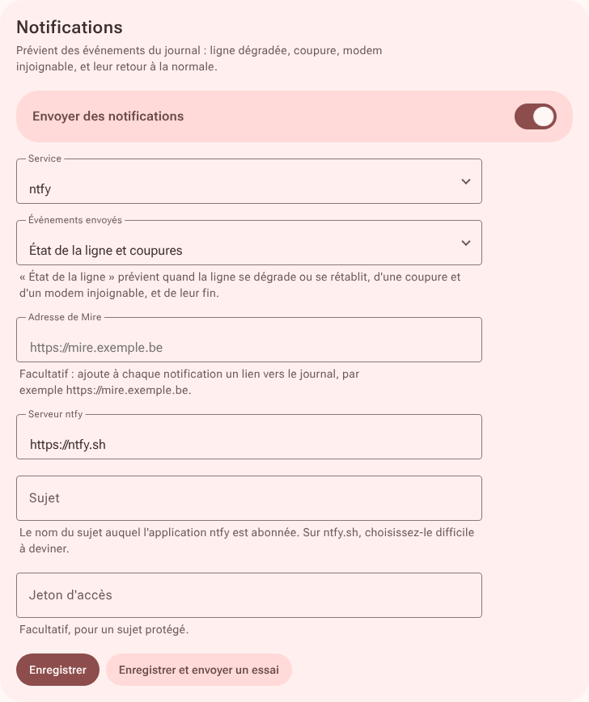

# Intégrations

Chaque intégration s'active dans **Réglages**, se vérifie avec « Enregistrer et tester », et accepte ses [variables d'environnement](configuration.md#variables-denvironnement).

## Débit

Mire lit tous les quarts d'heure les mesures de débit de l'une de ces sources :

- **[Speedtest Tracker](https://github.com/alexjustesen/speedtest-tracker)** : jeton créé dans API Tokens, avec le seul droit « Read results ». Tout l'historique est repris.
- **Passerelle UniFi** (Cloud Gateway, Dream Machine) : activez les tests de débit automatiques dans UniFi Network. Accès par une clé API (Paramètres, Intégrations) ou un compte local sans double authentification. Indiquez l'adresse sans port, par exemple `https://192.168.1.1`. UniFi Network ne fournit que le dernier test : l'historique commence à l'activation. Seuls les tests de la connexion principale sont repris.

## Notifications



Services : **ntfy**, **Gotify**, **Discord**, **Telegram**, **Slack**, **mail** ou **webhook**. « Enregistrer et envoyer un essai » vérifie la configuration.

| Événements envoyés | Contenu |
|---|---|
| État de la ligne et coupures (par défaut) | ligne dégradée ou rétablie, coupure d'Internet, modem injoignable, et leur fin |
| Alertes critiques seulement | ce qui est critique |
| Tout le journal | chaque événement |

- Les événements proches partent en un seul message.
- Un envoi en échec est retenté pendant une heure.
- Avec l'adresse de Mire renseignée, chaque message mène au journal.
- Le webhook reçoit un JSON : `titre`, `message`, `niveau` (`bon`, `avertissement`, `critique`, `information`), `evenements`, `heure`, `lien`.

## Métriques

Format Prometheus sur `GET /metrics`, pour Prometheus, VictoriaMetrics, Grafana Alloy ou Telegraf. À activer dans **Réglages, Métriques**. Jeton facultatif, exigé alors en `Authorization: Bearer` (à créer avec `openssl rand -hex 24`).

| Métrique | Contenu |
|---|---|
| `mire_line_level` | état de la ligne : 0 non qualifié, 1 bon, 2 toléré, 3 à surveiller, 4 critique |
| `mire_channels_attention` | canaux à surveiller ou critiques |
| `mire_downstream_power_dbmv`, `mire_downstream_snr_db`, `mire_downstream_frequency_mhz` | par canal descendant (`channel`, `modulation`) |
| `mire_downstream_corrected_total`, `mire_downstream_uncorrected_total` | compteurs d'erreurs du modem, remis à zéro à son redémarrage : à lire avec `rate()` ou `increase()` |
| `mire_downstream_level`, `mire_upstream_level` | état par canal, même échelle que `mire_line_level` |
| `mire_upstream_power_dbmv`, `mire_upstream_frequency_mhz` | par canal montant |
| `mire_internet_up`, `mire_probe_latency_seconds`, `mire_probe_loss_ratio` | sonde Internet |
| `mire_last_reading_timestamp_seconds`, `mire_info` | heure du dernier relevé ; version, modem et profil |
| `mire_modem_up` | 1 si le modem répond et que le dernier relevé est récent |
| `mire_outages{window="24h"\|"30d"}`, `mire_last_outage_start_timestamp_seconds`, `mire_last_outage_duration_seconds` | coupures d'Internet, hors réseau local |
| `mire_modem_last_restart_timestamp_seconds` | dernier redémarrage du modem |

```yaml
# Prometheus, ou vmagent pour VictoriaMetrics
scrape_configs:
  - job_name: mire
    authorization: { credentials: "<jeton>" }   # si un jeton est défini
    static_configs:
      - targets: ["<machine>:1340"]
```

```alloy
// Grafana Alloy
prometheus.scrape "mire" {
  targets    = [{ __address__ = "<machine>:1340" }]
  forward_to = [prometheus.remote_write.default.receiver]
}
```

Tableau de bord Grafana : [docs/grafana/mire.json](grafana/mire.json), à importer dans **Dashboards, New, Import**. Ses repères de puissance sont ceux du profil VOO.

## Home Assistant

Mire publie sur un serveur MQTT avec la découverte automatique : un appareil **Mire** apparaît dans l'intégration MQTT. À activer dans **Réglages, Home Assistant** : serveur (`mqtt://192.168.1.10:1883`), identifiant et mot de passe.

| Capteur | Type | Contenu |
|---|---|---|
| Internet | sonde | connecté, ou déconnecté pendant une coupure |
| Signal | sonde | OK, ou problème si la ligne est à surveiller ou critique |
| Modem | sonde | connecté tant que ses relevés arrivent |
| État de la ligne | sonde | Bon, Toléré, À surveiller, Critique ou Non qualifié |
| Diagnostic | sonde | la cause en une phrase, comme au journal |
| Dernière coupure, Durée de la dernière coupure | coupures | début et durée en minutes |
| Coupures sur 24 h, Coupures sur 30 jours | coupures | hors réseau local |
| Dernier redémarrage du modem | coupures | heure du dernier redémarrage |
| Erreurs non corrigées sur 24 h | mesure | données perdues |
| Canaux à surveiller, Puissance descendante minimale et maximale, SNR le plus bas, Émission la plus forte | mesures | valeurs de la vue d'ensemble |
| Latence, Pertes | mesures | sonde Internet |
| Canaux descendants, Canaux montants, Dernier relevé | diagnostic | état de la collecte |

Bouton **Redémarrer le modem** (`button.mire_redemarrer`) : même règle que la page Modem, une demande par tranche de 10 minutes. Il se retire dans les réglages.

Exemple : prévenir quand le signal se dégrade.

```yaml
automation:
  - alias: Mire, signal dégradé
    triggers:
      - trigger: state
        entity_id: binary_sensor.mire_signal
        to: "on"
        for: "00:15:00"
    actions:
      - action: notify.notify
        data:
          title: Ligne câble
          message: "{{ states('sensor.mire_diagnostic') }}"
```

Sujets MQTT : `mire/etat`, `mire/disponibilite`, `mire/commande/redemarrer`. Un seul Mire par serveur MQTT.

## Supervision

`GET /sante` répond sans authentification :

```json
{"statut": "ok", "collecte": "a_jour", "dernier_releve": "2026-10-25T19:50:05Z", "modem": "Technicolor CGA4233 (firmware VOO)", "version": "v1.0.1"}
```

`collecte` vaut `a_jour`, `en_retard` (aucun relevé depuis trois intervalles), `en_attente` ou `inactive`. Une sonde HTTP sur le mot-clé `a_jour` alerte dès que le modem ne répond plus.

### Uptime Kuma

Deux sondes **HTTP(s) - Mot-clé** sur `http://<machine>:1340/sante` :

| Sonde | Mot-clé | Intervalle | Alerte quand |
|---|---|---|---|
| Mire | `"statut":"ok"` | 60 s | Mire ne répond plus, ou sa base est illisible |
| Collecte | `"collecte":"a_jour"` | 5 min | le modem ne donne plus de relevés |

Le mot-clé s'écrit sans espace, comme la réponse. Derrière un proxy avec authentification, laissez `/sante` accessible sans connexion.
